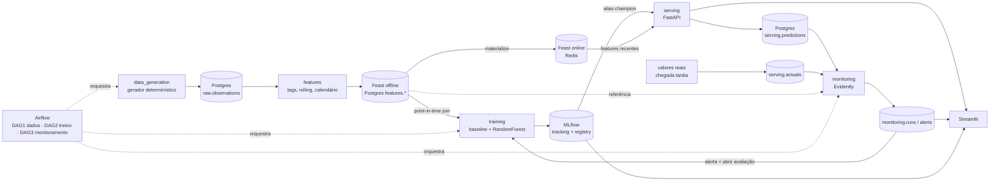

# Arquitetura — Time Series ML Platform

> Estado: **Fases 1 e 2 implementadas e testadas**. Fases 3–8 estão planejadas abaixo; nada marcado como "planejado" existe ainda no código.

## 1. Decisões arquiteturais

| # | Decisão | Justificativa | Alternativa descartada |
|---|---------|---------------|------------------------|
| D1 | **Python 3.11**, dependências resolvidas com `uv pip compile --python-version 3.11` e fixadas em `requirements/*.txt` | Versão comum a todo o stack; resolução reproduzível | 3.12 (menos testada com Airflow/Feast) |
| D2 | **pandas 2.x (<3)** | Feast 0.67 e Evidently 0.7 resolvem com pandas 2.3; pandas 3 mudou dtypes de string | pandas 3 |
| D3 | **Um servidor Postgres, bancos e roles separados** por aplicação (`tsplatform`, `mlflow`, `airflow`, `feast`, `tsplatform_test`); dentro do banco da aplicação, schemas `raw`, `features`, `serving`, `monitoring` | Evita colisão de tabelas e de credenciais (requisito do enunciado) | Um único schema compartilhado |
| D4 | **Feast**: registry SQL no Postgres (banco `feast`), online store **Redis**, offline store **PostgreSQL** (schema `features`) | Nenhum arquivo local compartilhado entre containers | Offline em Parquet no volume (viola "sem arquivos temporários compartilhados") |
| D5 | **Airflow em imagem própria**; código da aplicação roda num venv separado da imagem via `ExternalPythonOperator` | As constraints oficiais do Airflow 3.3.2 fixam pandas 3.0.5 / pydantic 2.13.5, que conflitam com o stack da app (D2). Verificado em 2026-10-14 | Instalar tudo no mesmo ambiente |
| D6 | **Promoção via alias `champion`** do MLflow Model Registry; a API resolve `models:/<nome>@champion` na inicialização | Rollback = mover o alias, sem redeploy da API | Stages (depreciados no MLflow 3) |
| D7 | **Tempo**: timestamps *naive* em UTC, alinhados à hora, em todo o sistema | Evita ambiguidade de fuso e incompatibilidades Feast/Postgres | `timestamptz` |
| D8 | **Gerador determinístico**: `SeedSequence(seed, spawn_key=(índice_da_série, propósito))` | Adicionar séries não altera as existentes; perfil e ruído em streams independentes | Um RNG global sequencial |
| D9 | **Identidade do dataset** = hash da config + hash dos dados (`ds-<cfg8>-<dados8>`) | Linhagem: o MLflow registrará qual dataset treinou cada modelo | Nome/versão manual |
| D10 | **Persistência idempotente** por UPSERT na chave natural `(series_id, event_timestamp)` | Retries do Airflow e reexecuções não duplicam | INSERT puro + deduplicação posterior |
| D11 | **WAPE** como métrica percentual principal (MAPE só informativo) | Demanda pode chegar perto de zero; MAPE explode | Somente MAPE |
| D13 | **Semântica temporal**: a linha de features carimbada em *t* usa só observações `< t`; seu alvo é a observação carimbada em *t*. Linhas só existem com histórico completo (≥168 h contíguas); nada é imputado | Elimina vazamento por construção; "linha ausente" = histórico insuficiente | Preencher lacunas / warm-up com média |
| D14 | **Feast conecta no Postgres com `sslmode` configurável** (`APP_DB_SSLMODE`, `disable` só no container local) | O Feast exige TLS por padrão; o container `postgres:16-alpine` não tem TLS (descoberto nos testes reais) | Desligar TLS no código |
| D15 | **Primeira materialização usa `start = end − TTL`**; depois é incremental; `end` anterior ao último intervalo é no-op | O padrão do Feast (`agora − TTL`, relógio real) não materializa nada para dados históricos/simulados (descoberto no CLI) | Chamar `materialize_incremental` cego |
| D12 | **Deriva ≠ degradação**: alerta de drift só abre *avaliação* de retreino; promoção exige critérios de métrica | Requisito explícito do enunciado | Retreino/promoção automáticos |

### Riscos conhecidos (a validar nas fases indicadas)
- **Feast offline store em Postgres** é um componente *contrib*: **validado na Fase 2** (PIT join, TTL e materialização testados contra Postgres e Redis reais; ver testes). Mesmo assim, continua sendo contrib: acompanhe notas de versão ao atualizar o Feast. Fallback: Parquet em object storage (MinIO).
- **Registry × Redis divergentes**: se o Redis for apagado (flush, perda de volume) o registry continua dizendo "já materializado" e o `feast-materialize` incremental vira no-op. Recuperação: `feast-materialize --start <timestamp>` (reescreve o online store). Está no troubleshooting.
- **Airflow 3**: API de DAGs e operadores mudou em relação ao 2.x; consultar a documentação da versão fixada na Fase 6.
- **Docker não estava disponível no ambiente onde a Fase 1 foi construída**: Compose/Dockerfile foram validados apenas por sintaxe (YAML e `bash -n`), não executados. Veja "Validação" no README.

## 2. Fluxo de dados



**Semântica temporal (D13):** `linha[t]` = conhecimento no início da hora *t* (só dados `< t`); alvo de `linha[t]` = `y[t]`. A linha `t_último+1h` é a linha de *serving* (sem alvo ainda).

**Conceitos Feast (para estudo):**
- *Offline store*: histórico completo de features, usado no treino. Consulta por `(entity, timestamp)`.
- *Point-in-time join*: para cada linha do treino (série, instante *t*), devolve a feature mais recente com timestamp **≤ t** (dentro do TTL), nunca valores futuros.
- *Materialização*: copia os valores mais recentes do offline para o online store.
- *Online store*: lookup de baixa latência (Redis) por chave de entidade para a inferência.

## 3. Árvore de diretórios

`✔` = existe hoje · `○` = planejado.

```
ML-project/
├── ✔ pyproject.toml  .env.example  .gitignore  .gitattributes  .dockerignore
├── ✔ Dockerfile  docker-compose.yml
├── ✔ requirements/        base.in/.txt · dev.in/.txt · stack.in/.txt (stack completo, só resolvido)
├── ✔ docker/postgres/init/01-create-databases.sh
├── ✔ docs/ARCHITECTURE.md
├── ✔ README.md
├── ✔ src/tsplatform/
│   ├── ✔ config/            settings.py (Pydantic Settings, GeneratorConfig, SegmentConfig)
│   ├── ✔ contracts/         raw.py · features.py (nomes, TTL, feature_set_id, TrainingFrameInfo)
│   ├── ✔ data_generation/   generator.py · segments.py
│   ├── ✔ data_access/       db.py · tables.py · repositories.py
│   ├── ✔ observability/     logging.py (JSON + contexto + log_operation)
│   ├── ✔ cli.py             ingest · info
│   ├── ✔ features/          builder.py (lags, rolling deslocado, calendário, alvos)
│   ├── ✔ feature_store/     definitions.py · client.py · training_data.py
│   ├── ○ training/          Fase 3
│   ├── ○ evaluation/        Fase 3
│   ├── ○ model_registry/    Fase 3
│   ├── ○ serving/           Fase 4
│   ├── ○ monitoring/        Fase 5
│   └── ○ orchestration/     Fase 6 (único lugar que importa Airflow)
├── ✔ feast_repo/            feature_store.yaml (env vars) · definitions.py
├── ○ dags/                  dag_data · dag_training · dag_monitoring     (Fase 6)
├── ○ streamlit_app/         5 páginas                                    (Fase 7)
├── ○ docker/{airflow,mlflow,api,streamlit}/                              (Fases 3–7)
└── ✔ tests/{unit,integration}/   ○ tests/e2e/ (Fase 8)
```

## 4. Matriz de compatibilidade

Resolvida com `uv pip compile --python-version 3.11` em 2026-10-14. **"Resolvida" significa que o resolvedor encontrou um conjunto consistente; ainda não foi executada em runtime** (exceto as linhas marcadas ✔ testado).

| Componente | Versão | Status |
|---|---|---|
| Python | 3.11 | ✔ testes da Fase 1 rodaram em 3.11.15 |
| pandas / numpy | 2.3.3 / 2.4.6 | ✔ testado |
| pydantic / pydantic-settings | 2.14.1 / 2.15.0 | ✔ testado |
| SQLAlchemy (fixado `<2.1`) | 2.0.54 | ✔ testado (SQLite e PostgreSQL) |
| psycopg2-binary | 2.9.13 | ✔ testado |
| PostgreSQL (servidor) | 16 (imagem `postgres:16-alpine`) | ✔ lógica testada num Postgres embutido; imagem não executada |
| Redis (servidor) | 7 (`redis:7-alpine`) | imagem não executada; Feast testado contra Redis 6.2.14 |
| Feast (`[redis,postgres]`) | 0.67.0 | ✔ testado (apply, PIT, materialize, online) |
| MLflow | 3.17.1 | resolvida |
| Evidently | 0.7.23 | resolvida |
| scikit-learn | 1.9.1 | resolvida |
| FastAPI / uvicorn | 0.143.0 / 0.54.0 | resolvida |
| Streamlit | 1.65.0 | resolvida |
| redis-py / psycopg (v3) | 7.4.1 / 3.3.6 | ✔ testado (via Feast) |
| pyarrow / protobuf | 25.0.1 / 6.33.6 | resolvida (transitivas) |
| Apache Airflow | 3.3.2, constraints oficiais py3.11 | **conflita** com a app no mesmo ambiente → D5 |

## 5. Plano de implementação e validação

| Fase | Entrega | Validação (critério verificável) | Estado |
|---|---|---|---|
| 1 Fundação | config, gerador, contratos, persistência, Compose inicial, testes | `pytest` verde; mesma seed ⇒ mesmo `dataset_id`; `ingest` 2× não duplica linhas | **feito** (Docker não executado) |
| 2 Feature Store | features sem vazamento, repo Feast, PIT join, materialização, online | teste de vazamento (feature em *t* usa só dados < t); PIT ≠ join ingênuo; Redis responde | **feito** (Docker não executado) |
| 3 Treino + MLflow | baseline, RandomForest, split temporal, métricas, registry, alias `champion` | candidato reprovado **não** é promovido; rollback move o alias | próxima |
| 4 Serving | FastAPI, contratos, features via Feast online, persistência | `/ready` falso sem modelo; previsão persistida com versão | |
| 5 Monitoramento | Evidently (data/prediction drift, performance), alertas | sem rótulos ⇒ "performance não calculável"; janela pequena ⇒ sem alerta | |
| 6 Orquestração | 3 DAGs com retries/timeouts | DAGs importam sem I/O; execução ponta a ponta | |
| 7 Interface | 5 páginas Streamlit consumindo API/serviços | nenhuma lógica de inferência no Streamlit | |
| 8 Integração | e2e real, docs, troubleshooting, checklist dos 15 critérios | e2e sem mocks | |

## 6. Contratos entre etapas (Fase 1)

| Etapa → Etapa | Contrato | Garantias |
|---|---|---|
| gerador → persistência | DataFrame `series_id, event_timestamp, target_value, is_anomaly` (`contracts/raw.py`) | UTC naive, hora cheia, `target ≥ 0`, sem duplicatas `(série, instante)`, sem nulos |
| persistência → consumidores | `raw.observations` (PK natural) + `raw.datasets` (identidade e hashes) | upsert idempotente; leitura em intervalo semiaberto `[start, end)` |
| `is_anomaly` | rótulo de verdade do gerador | **nunca** usado como feature |

Segmentos cronológicos padrão (4368 h ≈ 26 semanas): treino 60 % · validação 15 % · teste 10 % · produção 15 % (a ser "reproduzida" hora a hora para simular tráfego e chegada tardia dos valores reais).

## 7. Contratos da Fase 2

| Etapa → Etapa | Contrato | Garantias |
|---|---|---|
| raw → features | `build_features(raw)` (`features/builder.py`) | só `shift(k≥1)`; janelas terminam em *t−1*; lacunas viram NaN e a linha é descartada (sem interpolar) |
| features → Feast offline | tabela `features.series_features` (PK série+instante) | upsert idempotente; só linhas completas |
| Feast offline → treino | `build_training_frame(store, raw_repo, segment)` | PIT join por (série, *t*); segmentos cronológicos; devolve `TrainingFrameInfo` (feature_set_id, hash, linhas descartadas) |
| Feast offline → online | `materialize(store, end)` | só linhas com carimbo ≤ `end`; 1ª vez `start=end−TTL`; depois incremental |
| Feast online → inferência | `online_features(store, series_ids)` | `status="ok"` ou `"not_found"`; nunca preenche faltantes |

Provas (testes): `tests/unit/test_features_leakage.py` (11 testes, incluindo "alterar y[k] não move nenhuma feature carimbada ≤ k") e `tests/integration/test_feast.py` (10 testes contra Postgres e Redis reais, incluindo "online == PIT histórico no mesmo instante").
